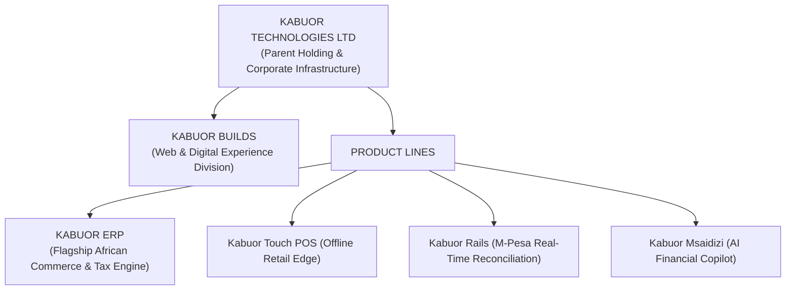

# Brand Architecture: Kabuor Technologies, Kabuor Builds & Kabuor ERP

This document formalizes the official corporate, studio, and product brand architecture for the organization.

---

## 1. Executive Summary

| Entity / Tier | Brand Name | Purpose & Domain |
| :--- | :--- | :--- |
| **Parent & Corporate Entity** | **Kabuor Technologies** (`kabuortechnologies.com` / `kabuor.co`) | Holding company, corporate governance, venture capital fundraising (Series A), legal entity, cap table, IP ownership, and institutional talent acquisition. |
| **Studio & Web Engineering Division** | **Kabuor Builds** (`kabuorbuilds.com`) | Web design, client digital storefronts, marketing websites, public documentation, and consumer-facing web experiences. |
| **Flagship Product** | **Kabuor ERP** (`app.kabuor.com` / `erp.kabuor.com`) | Enterprise Resource Planning software, offline-first point-of-sale, automated M-Pesa ledger sync, and KRA eTIMS tax compliance engine. |

---

## 2. Visual Hierarchy & Usage Guidelines

---

## 3. Brand Deployment Matrix

### A. Corporate & Institutional (Kabuor Technologies)
*Use for:*
- Delaware / Kenyan incorporation documents and regulatory licenses (KRA, CBK, ODPC).
- Series A pitch decks and investor relations (e.g. correspondence with Dr. Kennedy Oyoo, institutional venture capitalists).
- Executive employment agreements, ESOP stock option grants, and talent acquisition.
- Company-wide policies, audit filings, and patent registrations.
- Official footer: *"Kabuor Technologies Ltd · Nairobi, Kenya"*

### B. Digital & Studio (Kabuor Builds)
*Use for:*
- Custom marketing websites, merchant shopfronts, and public landing pages.
- Design showcase, brand case studies, and engineering blog.
- Client digital transformation projects and custom web integrations.
- Attribution tag: *"Websites engineered by Kabuor Builds"*

### C. Software & Platform (Kabuor ERP)
*Use for:*
- The running web and mobile application used by cashiers, store owners, and accountants.
- Point of sale (POS) receipt headers, invoice PDF stamps, and KRA eTIMS QR codes.
- Merchant WhatsApp communities, onboarding wizards, and in-app helpdesk.
- Product mark: Blue & gold price-tag emblem with bold **K** monogram.

---

## 4. Standard Taglines

- **Kabuor Technologies**: *"Engineering the Financial Infrastructure of African Commerce."*
- **Kabuor Builds**: *"Crafting Fast, Resilient Digital Experiences for Africa's Builders."*
- **Kabuor ERP**: *"Run the whole business from one place."*
