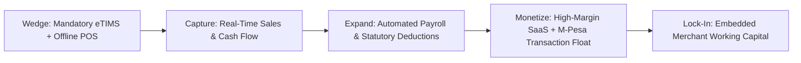

# Kabuor ERP — Series A Investor Memorandum

**Confidential** | Prepared for Institutional Series A Due Diligence  
**Company**: Kabuor ERP (Kabuor Builds Ltd.)  
**Category**: Enterprise Fintech / Vertical SaaS & Operating System  
**Geography**: East Africa (HQ: Nairobi, Kenya)  
**Valuation Target**: $12,000,000 – $15,000,000  

---

## 1. Company Purpose

**Kabuor ERP is the compound business operating system and financial ledger for East African commerce.** We replace fragmented, disconnected accounting tools with a unified system of record that natively binds mobile money (M-Pesa), statutory fiscal compliance (KRA eTIMS), inventory, and automated payroll into a single operational core.

---

## 2. The Thesis: The "Compound Startup" in Emerging Markets

Most enterprise software in developing economies fails because it imports Western architectural assumptions into an ecosystem where the financial rails are fundamentally different:

1. **The Core Financial Rail is Not a Bank Account; It is M-Pesa:**
   In Kenya, over 80% of B2B and retail transactions settle via Safaricom M-Pesa (Paybills and Tills). Traditional ERPs (SAP, NetSuite, Odoo, QuickBooks) treat mobile money as an afterthought—an external webhook that requires custom integration partners, bespoke middleware, and daily manual reconciliation.
2. **Compliance is a Forcing Function, Not a Feature:**
   The Kenya Revenue Authority (KRA) has legally mandated that every commercial sale must be cryptographically signed in real time via **eTIMS (Electronic Tax Invoice Management System)** to qualify as a deductible business expense. Non-compliant businesses face 200% tax penalties. Imported ERPs cannot natively fiscalize without expensive third-party hardware or fragile partner bridge-software.
3. **The Point-Solution Trap:**
   A typical Kenyan distributor runs on:
   - Tally or QuickBooks for bookkeeping (offline, siloed, delayed).
   - An M-Pesa web portal on a cashier's phone (unlinked to invoices).
   - Physical KRA ESD hardware or Excel CSV uploads for tax returns.
   - WhatsApp messages and physical carbon-copy paper receipts on the shop floor.

**The Solution**: Following the "Compound Startup" playbook pioneered by Rippling, Kabuor ERP rejects the point-solution model. By building the core primitives—**the General Ledger, the eTIMS Fiscalizer, the Daraja M-Pesa Pipe, and the POS Kiosk**—on a unified multi-tenant database, data moves frictionlessly across all business workflows without integration glue.

---

## 3. The Wedge & Expansion Flywheel

Our customer acquisition strategy leverages a regulatory and operational wedge that drives a **sub-3-minute time-to-value**:

### Phase 1: The Regulatory Wedge (Instant Value)
* Any business selling goods or credit must comply with eTIMS. Kabuor ERP's self-serve onboarding wizard configures their catalog, issues their first compliant cryptographic tax receipt, and links their M-Pesa Till in **under 180 seconds**.
* Cashiers and kiosks install our lightweight Progressive Web App (PWA) with zero hardware investment. It continues selling offline during fiber cuts and syncs atomically when the network returns.

### Phase 2: System of Record Expansion
* Once transactions flow through Kabuor ERP, the business naturally activates payroll (automated statutory calculation for PAYE, NSSF, SHIF, and Housing Levy), inventory replenishment, and supplier purchase orders.
* **Negative Churn Dynamics**: Ripping out Kabuor ERP means unhooking the business's tax filing status, their physical checkout registers, and their primary mobile money collection channel.

### Phase 3: The Fintech Flywheel (Embedded Finance)
* Unlike banks that rely on outdated, audited annual statements, Kabuor ERP has real-time, tamper-proof visibility into daily inventory turnover, debtor days, and net cash flow.
* This unlocks high-margin **embedded merchant working capital loans**, underwritten directly from the ERP ledger with automated daily repayment deduction from incoming M-Pesa receivables.

---

## 4. Counter-Positioning & Defensibility

Why can't global SaaS giants or regional software shops replicate Kabuor ERP?

| Competitor Tier | Their Model | Why They Are Structurally Disadvantaged |
| :--- | :--- | :--- |
| **Global ERPs** *(SAP, NetSuite, Odoo)* | Horizontal, multi-country codebases; seat-based dollar pricing; partner consulting model. | **Cannot localize at their price point.** Building native KRA OSCU/VSCU cryptographic protocols and Safaricom C2B/B2C pipes into a global core breaks their generalized abstractions. Their $50/seat/month pricing is unviable for emerging market kiosks. |
| **Legacy Accounting** *(QuickBooks, Tally, Sage)* | Desktop or US-centric cloud apps; manual bank feeds; periodic batch reconciliation. | **Architecturally blind to real-time mobile money.** They lack instant USSD push triggers, offline POS edge resilience, and WhatsApp/SMS transaction dispatch. |
| **Local Custom Dev Shops** | Bespoke project-based agency model (KSh 150k–500k one-off fee); single-tenant unmaintained deployments. | **No network effects, zero economies of scale.** They suffer from brittle codebases, manual server maintenance, zero automated regression testing, and high maintenance churn. |

---

## 5. Architectural Rigor & Unit Economics

Our underlying architecture guarantees venture-scale software margins:

* **Engineered for Extreme Cost Efficiency**:
  Built on .NET 10 Minimal APIs and React 19. Our high-throughput multi-tenant engine achieves **500,000+ daily transactions across 20+ tenant companies** on minimal cloud compute.
* **Gross Margin Profile**:
  - Subscription Revenue: **85% – 90% Gross Margin** (Cloud hosting consumes < 5% of ARR).
  - Transaction Take-Rate: **65% – 75% Gross Margin** on payment orchestration.
* **Capital Efficiency**:
  Zero sales engineering required for SMB tiers. Product-led growth (PLG) enables self-serve conversion, driving a **CAC Payback period of < 5 months**.

---

## 6. Financial Targets & Series A Milestones

* **Current Status**: Production-hardened core, 127/127 automated regression tests passing, zero-downtime migrations, live KRA eTIMS signing engine.
* **18-Month Post-Financing Milestones**:
  - Expand from 250 to 5,000 paying mid-market and retail merchants.
  - Scale ARR from $350k to $2,800,000 (8x growth).
  - Reach $120M in annualized gross merchandise value (GMV) processed through the core ledger.
  - Launch pilot for embedded invoice financing in partnership with regional Tier-1 commercial banks.

---

## 7. The Ask

We are raising a **$2,500,000 Series A round** to accelerate merchant acquisition across Kenya's urban commercial corridors (Nairobi, Mombasa, Kisumu, Nakuru, Eldoret) and deepen our embedded finance underwriting rails.
